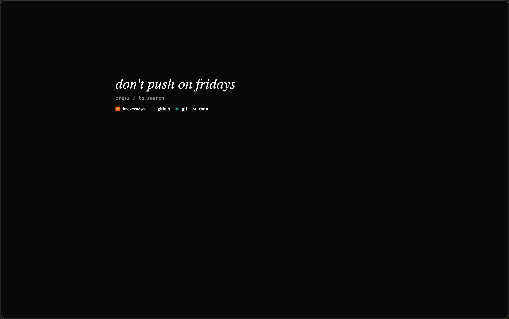
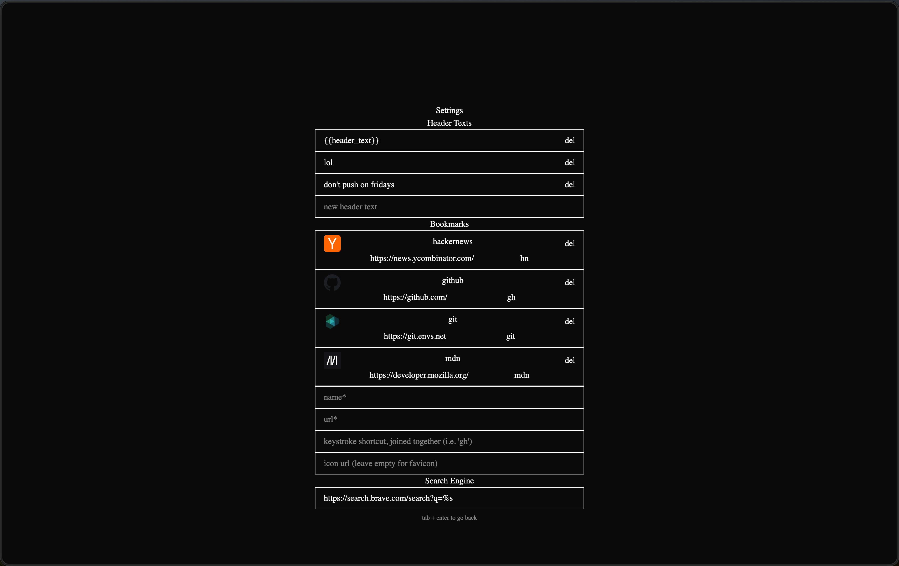

# Startpage

Startpage is a project heavily inspired by [fmhy.net/startpage](https://fmhy.net/startpage).
It aims to be a simple, keyboard-first interface for new tabs, making better
use of space that is usually empty.

<p align="center">
  
  
</p>

> [!note]
> Startpage is still under development and stuff may change before v1.

## Public Instance

TBD

## Features

- Simple UI
- Keybindings for bookmarks and search
- Edit page for header texts, bookmarks, and the search engine.
- Configuration saved in local storage
- Docker image for self-hosting

### Planned

- Browser extension for rewriting new tab page
- Multiple search engines
- Syncing configuration across devices
- Overwrite default configuration

## Usage

- `/` to focus search
  - search `/edit` to open edit page
- Typing a bookmark's shortcut will open it, when search is not focused
- `Esc` to unfocus search and clear shortcut input
- In edit page, `Tab` + `Enter` to return to startpage

## Customization

In the `/edit` page you can customize the following:

- Adding header texts, deleting header texts
- Adding bookmarks, deleting bookmarks
- Changing the search engine

## Installation

Prerequisites:

- Node.js
- pnpm (npm would probably work too, not tested)

```sh
# 1. Clone the repository
git clone https://github.com/axmc/startpage.git

# 2. Install dependencies
pnpm install

# 3. Start dev server
pnpm dev

# (optional) 4. Build for production
pnpm build

# (optional) 5. Preview production build
pnpm preview
```

## License

Startpage is licensed under the [MIT License](LICENSE).
